# [프로젝트명] — 웹게임(2D) 기반 그래픽 실습

> 컴퓨터그래픽스(2) | 2026학년도 2학기 | 담당교수: 최도현
> 작성자: (20220961) / (강승원)
> 최종 수정일: (2026-12-DD)

---

## 목차

1. [프로젝트 개요](#1-프로젝트-개요)
2. [개발 환경](#2-개발-환경)
3. [x 주차 별 세부 내용]
4. [실행 방법](#5-실행-방법)
5. [트러블슈팅 기록](#6-트러블슈팅-기록)
6. [참고 자료](#7-참고-자료)

---

## 1. 프로젝트 개요

    | 항목 | 내용 |
    |---|---|
    | 프로젝트명 | Dungeon Survivor 2D |
    | 장르 | 2D 탑뷰 서바이벌 액션 (Vampire Survivors 스타일) |
    | 플랫폼 | Web (WebGL2) |
    | 조작 | WASD / 방향키 이동, 자동 공격 |
    | 한 줄 소개 | 기사를 조작해 몰려오는 슬라임을 처치하고, 레벨업과 상점 강화로 오래 살아남는 2D 서바이벌 게임 |

---

## 2. 개발 환경

| 항목 | 값 |
|---|---|
| Unity 버전 | 6000.5.1f1 |
| Render Pipeline | Universal RP (2D Renderer) |
| Input System | New Input System (Input System Package) |
| UI | TextMesh Pro |
| 웹 빌드 | WebGL 2 (WebGPU 실험적 지원 별도) |

---

## 3. 2주차 — 프로젝트 준비 & 웹 빌드

### 3.1 프로젝트 초기 세팅

- [x] Unity 6000.5.1f1로 2D URP 템플릿 프로젝트 생성
- [x] `2주차_StarterProject.unitypackage` 임포트
- [x] `CG2 Starter → Step 1 → Step 2 → Step 3` 순서로 씬 빌드
- [x] ▶ Play 버튼으로 정상 동작 확인 (WASD 이동, 자동 공격, 적 스폰)

### 3.2 씬 구성 요약

```
Player      SpriteRenderer(Order 2) · Rigidbody2D · CircleCollider2D
            PlayerController · HitReceiver · Health · WeaponController

Enemy       SpriteRenderer(Order 1) · Rigidbody2D · CircleCollider2D
            EnemyAI · HitReceiver · Health

Projectile  SpriteRenderer(Order 3) · Rigidbody2D · CircleCollider2D(Trigger)
            Projectile

Canvas      Screen Space - Overlay · HUD(Script)
            HpBar / ExpBar / ScoreText / LevelText / TimeText / GameOverPanel
```

### 3.3 웹 빌드 확인

- [x] `File → Build Profiles → Web → Build And Run`으로 브라우저 실행 확인
- [x] 빌드 소요 시간: 약 ( )분
- [x] 브라우저 정상 실행 여부: (예/아니오)

**웹 빌드 vs 에디터 Play 차이**

| 항목 | 에디터 Play | 웹 빌드 |
|---|---|---|
| 실행 속도 | 즉시 | 1~3분 |
| 확인 목적 | 로직 테스트 | 실제 브라우저 동작 확인 |

### 3.4 GitHub 업로드 체크리스트

- [x] `.gitignore`에 `Library/`, `Temp/`, `Obj/`, `Build/`, `Logs/`, `UserSettings/` 포함 확인
- [x] `Assets/`, `ProjectSettings/`, `Packages/`는 반드시 포함
- [x] 개별 파일 100MB 초과 여부 확인 (대용량은 Git LFS 고려)

### 3.5 2주차 문제 
| PPU 32 | Scale 2 |
| :---: | :---: |
|  |  |

PPU 32와 Scale 2 비교

두 실행 화면에서 파란색 플레이어 원은 거의 같은 크기로 보였다. PPU를 64에서 32로 낮추거나 Transform Scale을 1에서 2로 높이면, 두 경우 모두 스프라이트의 가로와 세로가 월드에서 각각 2배가 된다.

PPU 32는 스프라이트 이미지의 픽셀을 월드 크기로 환산하는 기준을 바꾼다. 같은 스프라이트 에셋을 사용하는 다른 오브젝트에도 적용된다.

Scale 2는 선택한 오브젝트의 Transform 크기를 2배로 늘린다. 해당 오브젝트에 붙은 콜라이더와 자식 오브젝트도 함께 스케일된다.

## 3주차 — Batching과 Sprite Atlas

### 실습 내용 정리

SRP Batcher와 Sprite Atlas를 각각 켜고 끄면서 Draw Calls, SetPass, 텍스처 수, 텍스처 메모리, FPS를 비교했다.

- **SRP Batcher**는 렌더링 상태를 준비하는 CPU 비용을 줄인다. Draw Calls가 그대로여도 SetPass가 줄어들 수 있다.
- **Sprite Atlas**는 여러 스프라이트를 하나의 텍스처로 묶는다. 텍스처 전환과 Draw Calls를 줄일 수 있고, 아틀라스 크기에 따라 텍스처 메모리는 늘어날 수 있다.
- **Frame Debugger**에서는 SRP Batcher ON/OFF에 따라 렌더링 트리에 표시되는 항목과 드로우콜 줄 수를 비교했다.

### 성능 측정 기록표

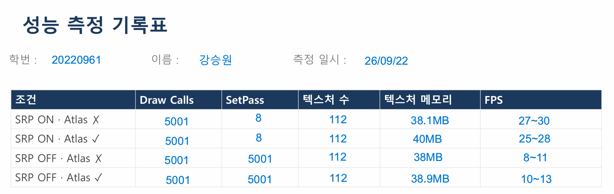

### Frame Debugger 관찰 기록표

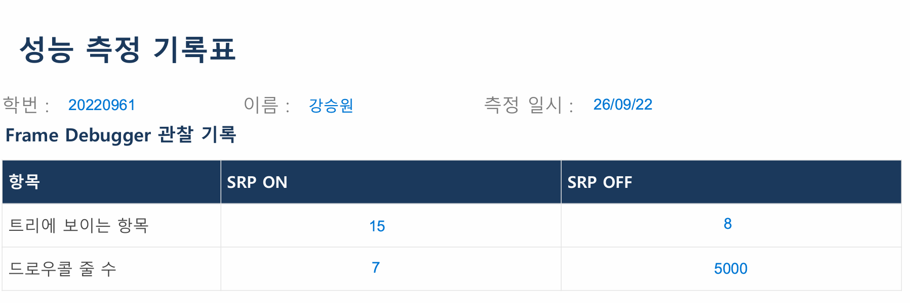

### Frame Debugger 캡처 비교

| SRP ON | SRP OFF |
| :---: | :---: |
|  |  |

## 4주차 — Tilemap 렌더링 최적화

### 실습 내용 정리

TilemapLab에서 Chunk와 Individual 렌더링을 비교하고, 텍스처 구성과 청크 컬링 설정이 Draw Calls, SetPass, Tris, FPS에 어떤 영향을 주는지 확인했다.

- **Chunk 모드**는 타일을 청크 단위로 묶어 그린다. #1 Chunk는 Draw Calls 2회, #2 Individual은 1,401회였다. Individual에서 Tris는 줄었지만, FPS도 101에서 18.2로 낮아졌다.
- **청크 컬링**은 카메라에 보이지 않는 청크를 렌더링에서 제외한다. #4에서 컬링 범위를 수동으로 넓히자 Draw Calls는 2회로 같았지만, Tris는 8,193에서 10,241로 늘었다.
- 바닥처럼 캐릭터와 앞뒤 정렬이 필요 없는 타일은 Chunk를 사용하고, 캐릭터와의 정렬이 필요한 타일은 별도 타일맵에 두고 Individual을 적용할 수 있다.

### 측정 기록표

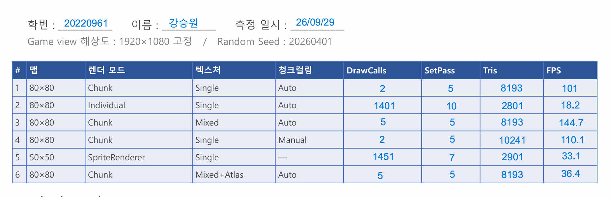

### Game 뷰 Stats 비교

| #1 Chunk | #2 Individual | #6 Mixed + Atlas |
| :---: | :---: | :---: |
|  | 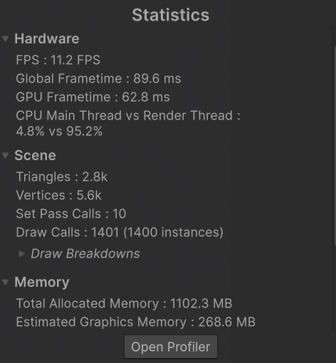 | 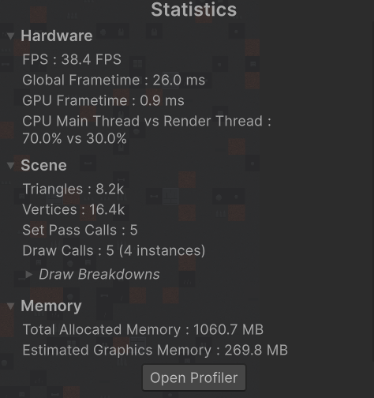 |

### 추가 분석 — Mixed와 Mixed + Atlas 비교

#3 Mixed와 #6 Mixed + Atlas는 Draw Calls 5회, SetPass 5회, Tris 8,193으로 같았다. 기록된 FPS는 #3에서 144.7, #6에서 36.4였다. 이번 측정에서 Atlas 적용 후 Draw Calls나 SetPass의 감소는 관찰되지 않았다. FPS 차이의 원인은 이 기록만으로 확인하기 어려우므로, 같은 조건에서 여러 번 측정해 비교할 필요가 있다.

## 5주차 — 카메라·UI 구성과 AI 에셋 적용

### 학습 내용 요약

- Cinemachine의 Follow와 Confiner 기능을 활용하여 플레이어를 따라가면서 맵 밖을 비추지 않는 카메라 구성을 학습하였다.
- 직교 카메라의 Size, 화면 해상도, PPU가 스프라이트의 화면 표시 크기에 미치는 영향을 확인하였다.
- UI Canvas를 합치거나 분리할 때 드로우콜과 UI 재구성 범위 사이에 차이가 발생한다는 점을 학습하였다.
- AI로 생성한 이미지를 Art Studio에서 배경 제거, 크기 조정, 외곽선 처리 등을 거쳐 게임용 스프라이트로 가공하였다.
- 에셋 교체 후 Sprite Atlas를 재적용하고, 에디터와 웹 브라우저에서 기존 에셋과 AI 에셋의 성능을 비교하였다.


### 측정 기록표

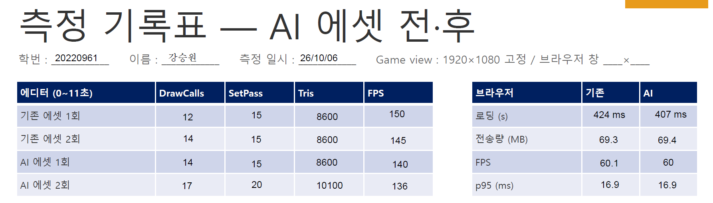

### AI 이미지 가공 및 게임 적용 비교

| AI 이미지 가공 — Art Studio | AI 에셋 적용 — Game 뷰 |
| :---: | :---: |
| 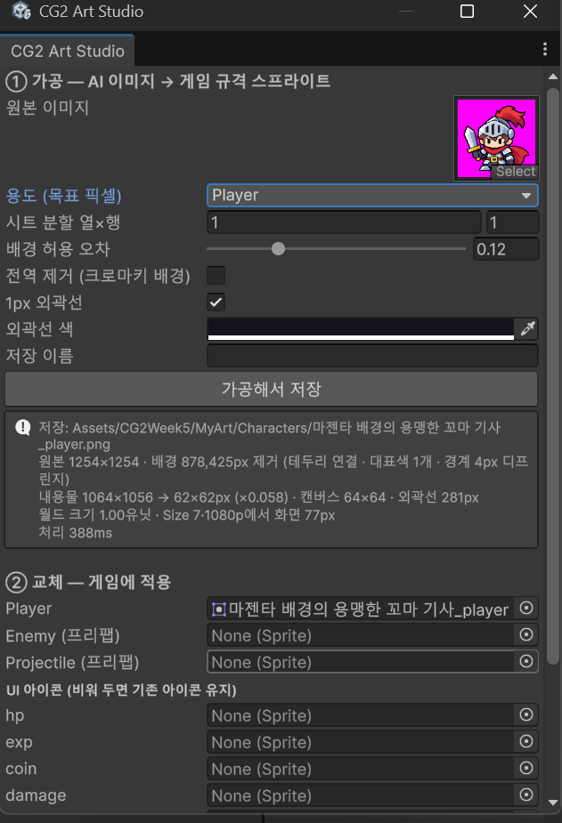 | 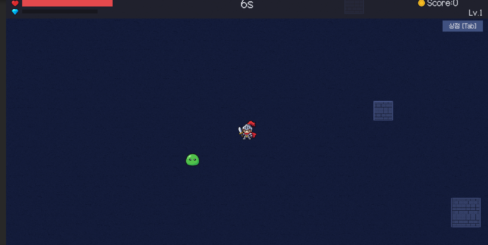 |

Art Studio에서 기사 이미지를 Player 용도로 설정하고 64×64px 캔버스로 가공했다. 적용 화면에서는 기사와 슬라임이 어두운 바닥과 대비되어 캐릭터의 위치와 종류를 구분하기 쉬웠다.


### 추가 분석

#### 1. 에디터에서는 AI 에셋 적용 후 렌더링 수치가 증가하였다.

2회 측정의 평균을 비교하면 DrawCalls는 13에서 15.5로, SetPass는 15에서 17.5로 증가하였다. Tris는 8,600에서 9,350으로 증가했으며, FPS는 147.5에서 138로 약 6.4% 감소하였다.

다만 AI 에셋 1회에서는 SetPass와 Tris가 기존 에셋과 같았고, 2회에서 함께 증가하였다. 따라서 이번 결과만으로 AI 이미지 자체가 성능 저하의 원인이라고 단정하기는 어렵다. 적과 투사체 수, UI 창 표시 여부, 아틀라스 적용 상태 등의 조건을 확인하고 같은 상태에서 반복 측정할 필요가 있다.

#### 2. 브라우저에서는 전후 성능 차이가 작았다.

브라우저 FPS는 기존 60.1, AI 60.0으로 거의 같았고, p95 프레임 시간도 16.9ms로 동일하였다. 측정된 프레임 지표에서는 에셋 교체 후 뚜렷한 차이가 나타나지 않았다.

다만 약 60FPS로 동작하는 환경에서는 화면 주사율이나 VSync의 영향으로 성능 여유의 차이가 FPS에 드러나지 않을 수 있다. 따라서 FPS와 프레임 시간을 함께 확인하는 것이 필요하다.

#### 3. 전송량과 로딩 시간의 변화는 작았다.

전송량은 69.3MB에서 69.4MB로 약 0.14% 증가하였다. 로딩 시간은 424ms에서 407ms로 17ms 짧아졌다.

전송량이 증가했는데도 로딩 시간이 감소했으므로, 이 결과를 AI 에셋의 로딩 성능 개선으로 해석하기는 어렵다. 캐시, 로컬 서버 상태, 측정 시점 등의 영향을 확인하기 위해 동일한 캐시 조건에서 반복 측정해야 한다.

## 6주차 — 색 공간과 아트 가이드

### 실습 내용 정리

- Linear와 Gamma 색 공간에서 조명과 텍스처의 색 표현 차이를 비교하고, 색상 이미지와 데이터 텍스처의 sRGB 설정 기준을 학습했다.
- 팔레트를 기준으로 UI 상태색과 씬 톤을 적용하고, 색상 변경 방식과 폰트 구성이 렌더링 비용에 미치는 영향을 측정했다.
- 배경과 캐릭터의 조명을 분리하여 가독성을 확인하고, 테마 전환과 흑백·색약 미리보기로 색상 전달 방식을 점검했다.

### 측정 기록표

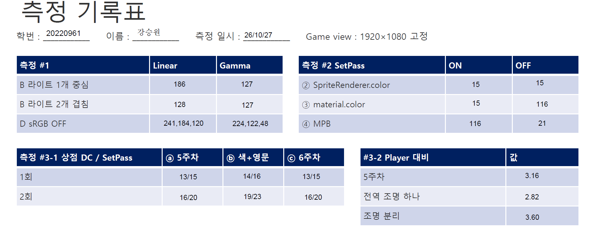

### 5주차와 6주차 메인 화면 비교

| 5주차 — 적용 전 | 6주차 — 팔레트·씬 톤 적용 후 |
| :---: | :---: |
| 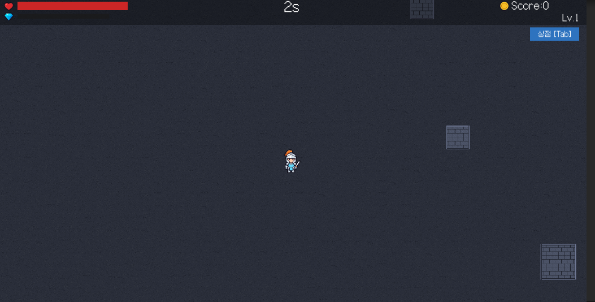 | 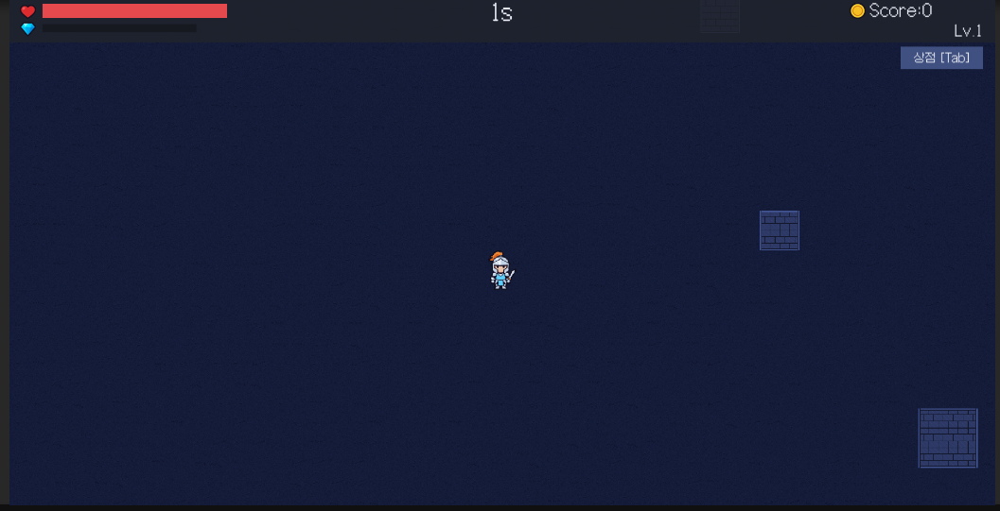 |

5주차의 회색 계열 바닥에서 6주차에는 남색 계열의 씬 톤으로 변경되었다. 배경과 UI에 색상 기준을 적용하면서 전체적인 분위기를 통일하고, 밝은 캐릭터가 배경과 구분되도록 구성했다.

### 테마 2종 비교

| 테마 1 — 청록색 계열 | 테마 2 — 검붉은색 계열 |
| :---: | :---: |
| 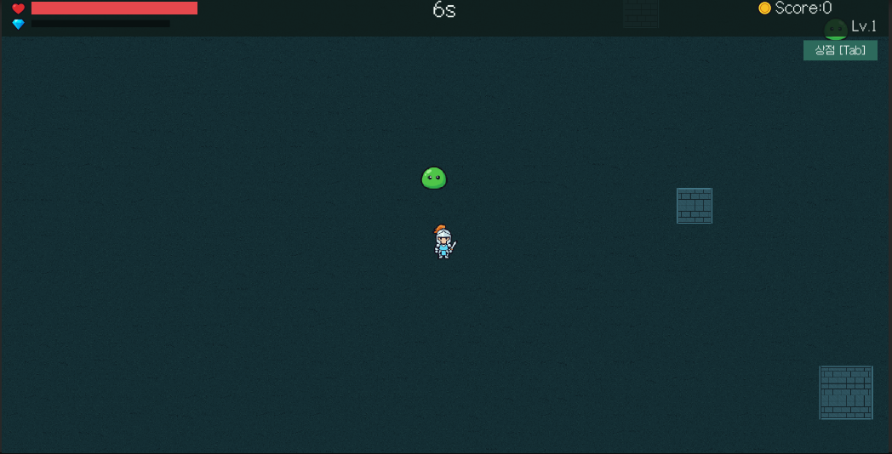 | 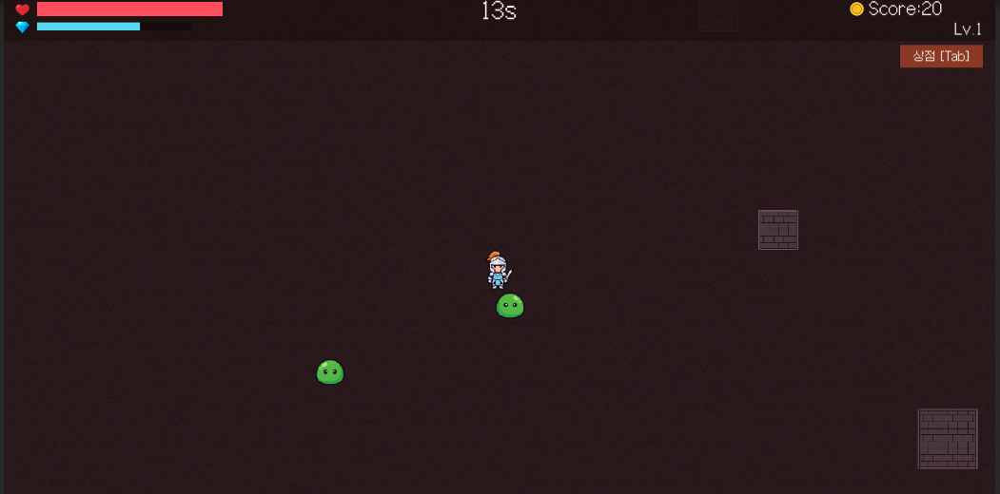 |

같은 맵과 캐릭터를 유지하면서 팔레트를 전환하여 화면 분위기를 변경했다. 바닥과 벽뿐 아니라 HUD와 상점 버튼에도 테마 색상이 반영되는 것을 확인했다.

### 흑백·색약 미리보기

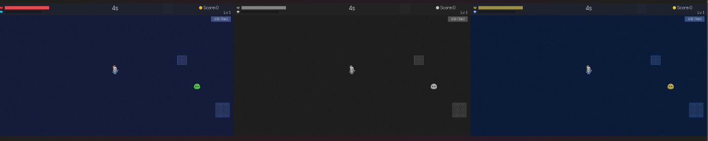

왼쪽부터 원본, 흑백, 적록 색약 미리보기이다. 색약 미리보기에서는 체력 바와 슬라임의 색상이 원본과 다르게 보이지만, 하트와 보석 아이콘 및 캐릭터의 형태가 정보를 구분하는 단서로 남는다. 색상만으로 기능을 구분하기보다 아이콘과 모양, 명도 차이를 함께 사용하는 것이 중요하다.

### 아트 가이드 및 팔레트

[아트 가이드 보기](WEB2D_20220961_Project/WEB2D_4_2022061/Assets/CG2Week6/ArtGuide/ArtGuide.md)

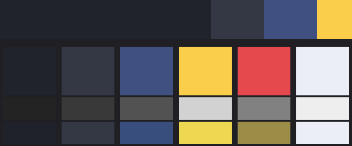

### 추가 분석 — Linear와 Gamma 비교

라이트 1개 중심의 측정값은 Linear에서 186, Gamma에서 127로 나타났다. 같은 조명 설정이라도 색 공간에 따라 화면에 출력되는 밝기가 달라지는 것을 확인했다.

라이트 2개 겹침 지점은 두 색 공간에서 비슷한 값이 기록되었지만, 라이트 1개 중심과는 측정 위치가 다르므로 두 행만으로 중첩에 따른 밝기 증가율을 계산할 수는 없다.

sRGB OFF 텍스처도 Linear와 Gamma에서 서로 다른 RGB 값으로 나타났다. 색상 이미지를 데이터 텍스처처럼 해석하면 의도한 색과 달라질 수 있으므로, 텍스처 용도에 맞는 sRGB 설정이 필요하다.

### 추가 분석 — 색상 변경 방식과 SetPass

SpriteRenderer.color는 SRP Batcher ON/OFF 모두 SetPass가 15로 같았다. 반면 material.color는 OFF에서 116으로 증가했고, MPB는 ON에서 116, OFF에서 21로 측정되었다.

이번 환경에서는 SpriteRenderer.color가 SetPass 증가 없이 색상을 변경했으며, MPB가 항상 더 유리하지는 않았다. 색상 변경 방식은 SRP Batcher 설정과 실제 측정 결과를 함께 보고 선택해야 한다. 또한 material.color는 머티리얼 인스턴스를 생성할 수 있어 SetPass 외에 메모리 관리도 고려해야 한다.

### 추가 분석 — 폰트 통일 전후 비교

상점 측정에서 ‘색+영문’ 상태는 5주차보다 Draw Calls와 SetPass가 모두 증가했다. 한글을 지원하는 폰트로 통일한 6주차 상태에서는 두 번 모두 5주차와 같은 수치로 돌아왔다.

이번 결과에서는 색상 변경 자체보다 영문 폰트와 한글 Fallback을 함께 사용하는 구성이 추가 렌더링 비용에 영향을 준 것으로 해석할 수 있다.

### 추가 분석 — 조명 분리와 캐릭터 가독성

Player 대비는 5주차에서 3.16, 전역 조명 하나를 적용했을 때 2.82, 배경과 캐릭터의 조명을 분리한 후 3.60으로 나타났다.

전역 조명 하나로 배경과 캐릭터를 함께 조정하면 분위기는 통일되지만 캐릭터도 어두워져 구분하기 어려워질 수 있다. 조명을 분리한 후에는 실습에서 사용한 대비 기준 3:1을 넘었으며, 배경의 분위기를 유지하면서 캐릭터 가독성을 개선할 수 있었다.

## 7주차 — Normal Map과 2D 입체감

### 실습 내용 정리

- 노멀 맵은 픽셀마다 표면의 방향을 저장하여, 평면 스프라이트에서도 조명 방향에 따른 명암과 입체감을 표현한다.
- 밝기·외곽·혼합 방식으로 노멀 맵을 생성하고, 캐릭터에는 혼합 방식, 벽과 바닥 타일에는 밝기 방식을 사용하는 이유를 학습했다.
- 노멀 맵을 Secondary Textures의 _NormalMap으로 연결하고, 조명의 Normal Maps 설정에 따른 입체감과 렌더링 비용을 비교했다.

### 측정 기록표

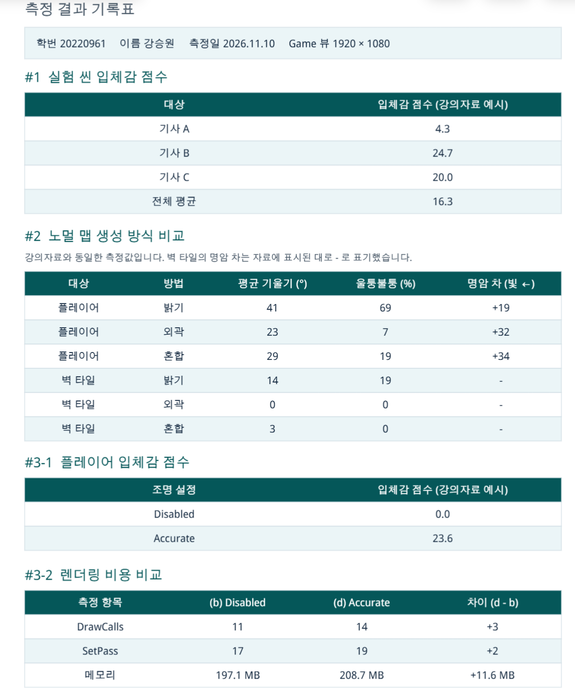

※ 기록표에 표시된 강의자료 예시 값을 기준으로 결과를 정리하였다.

### 실습 캡처

| 캡처 1 | 캡처 2 | 캡처 3 |
| :---: | :---: | :---: |
| 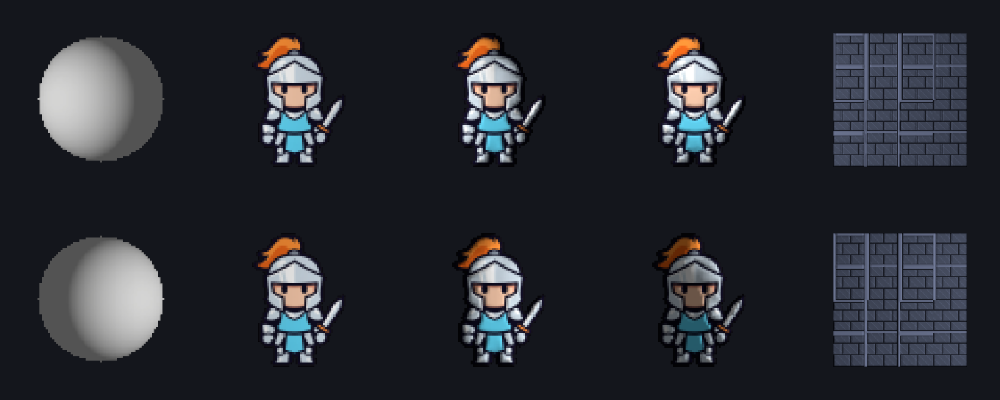 | 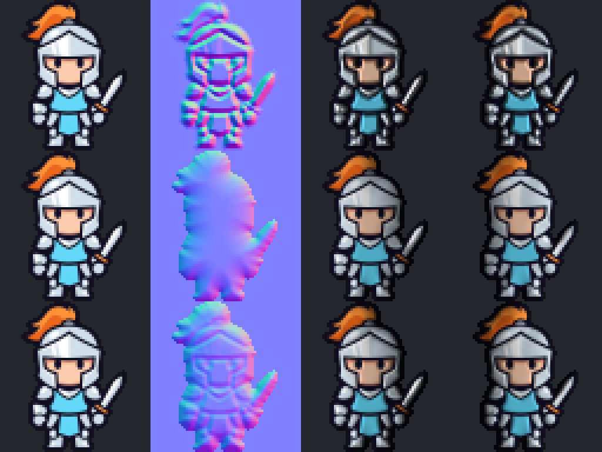 | 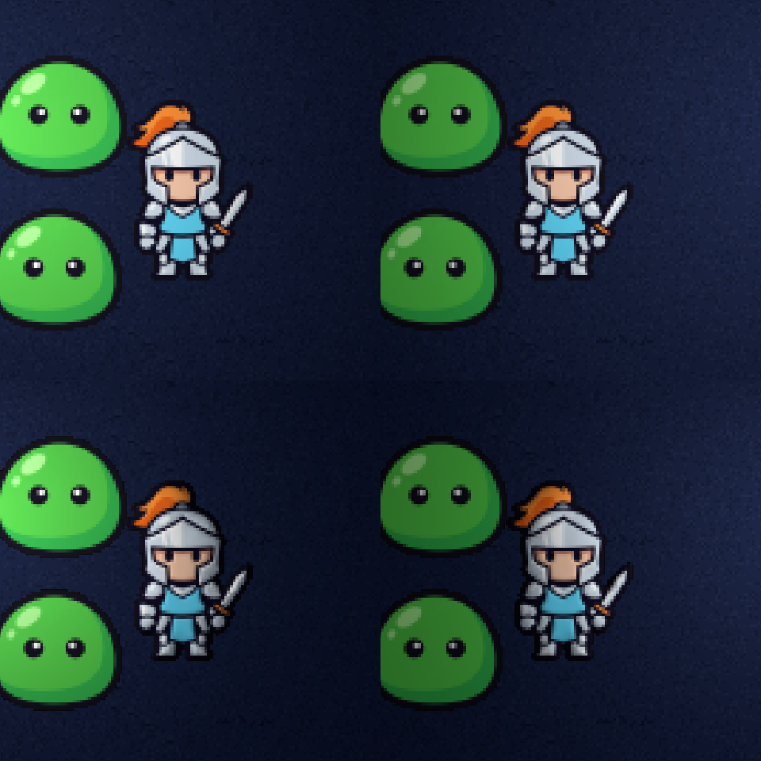 |

### 조명 이동 GIF

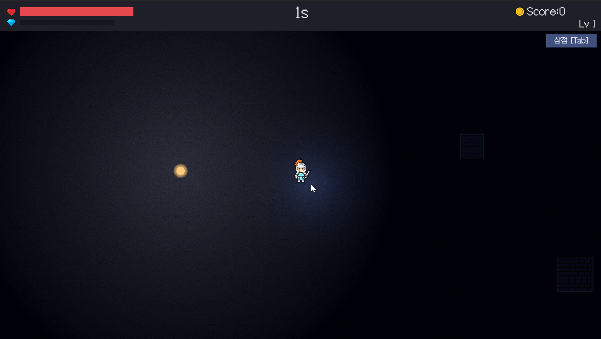

조명을 움직이며 빛의 방향에 따라 캐릭터와 타일의 명암이 어떻게 달라지는지 확인하였다. 정지 화면뿐 아니라 움직이는 조명에서도 표면의 밝은 부분이 변화하는지 살펴보았다.

### 추가 분석 — 노멀 맵 유무와 색 공간 설정

강의자료 예시에서 노멀 맵이 없는 기사 A보다 노멀 맵이 적용된 기사 B의 입체감 점수가 높았다. 픽셀마다 표면 방향이 달라지면서 조명 방향에 따른 명암 변화가 커진 결과이다.

sRGB가 켜진 기사 C도 입체감 점수는 나타났지만, 방향 데이터가 색상처럼 변환되어 잘못된 방향으로 해석된다. 따라서 점수가 높다는 사실만으로 올바른 결과라고 판단할 수 없으며, 노멀 맵의 sRGB OFF 설정과 실제 명암 방향을 함께 확인해야 한다.

### 추가 분석 — 노멀 맵 생성 방식 비교

플레이어의 밝기 방식은 울퉁불퉁한 픽셀 비율이 높았다. 그림의 어두운 외곽선과 그림자까지 낮은 높이로 해석하면서 표면이 과도하게 파인 것처럼 표현될 수 있다.

외곽 방식은 매끄러운 형태를 만들지만 내부 무늬 표현이 약해질 수 있다. 혼합 방식은 외곽의 둥근 형태와 밝기 기반의 세부 표현을 함께 반영하므로, 이번 기사 이미지에 적합한 방식으로 볼 수 있다.

벽 타일은 투명한 가장자리가 없어 외곽 방식의 기울기가 0으로 나타났다. 벽돌과 줄눈의 밝기 차이를 활용할 수 있는 밝기 방식이 타일의 표면 표현에 더 적합하다.

### 추가 분석 — 입체감과 렌더링 비용

기록표의 예시에서 Normal Maps를 Disabled에서 Accurate로 변경하면 플레이어 입체감 점수가 0.0에서 23.6으로 증가했다. 동시에 Draw Calls는 3회, SetPass는 2회, 메모리는 11.6MB 증가했다.

노멀 맵은 입체감을 더하지만 추가 렌더링과 메모리 비용이 발생한다. 따라서 화면에서 효과가 충분히 보이는지와 성능 부담을 함께 판단해야 한다. 이 차이는 현재 기록표의 비교값이며, 해상도와 조명 및 레이어 구성이 달라지면 다시 측정해야 한다.

### 추가 분석 — 조명 설정의 중요성

노멀 맵을 연결해도 Global Light만 사용하거나, 방향이 있는 조명의 Normal Maps가 Disabled이면 의도한 입체 반응을 확인하기 어렵다.

_NormalMap 연결과 sRGB OFF 설정을 확인한 뒤, Spot Light 2D의 Normal Maps를 활성화해야 한다. 또한 전역 조명이 너무 밝으면 명암 차이가 약해지므로, 주변광과 조명의 Distance를 함께 조정하는 것이 중요하다.

## 8주차 — 2D 라이트와 그림자

### 실습 내용 정리

- 바닥과 벽의 원본 이미지는 밝게 유지하고 환경광을 낮춰, 어두운 분위기에서도 조명이 만드는 명암 차이가 드러나도록 구성했다.
- 횃불·가로등·플레이어 랜턴을 배치하고, Shadow Caster 2D와 조명의 Shadows 설정으로 벽과 기둥이 빛을 가리도록 구성했다.
- 조명 전후의 명암 폭과 그늘 면적을 비교하고, 조명 및 그림자 조명 수에 따른 렌더링 비용을 측정했다.

### 측정 기록표

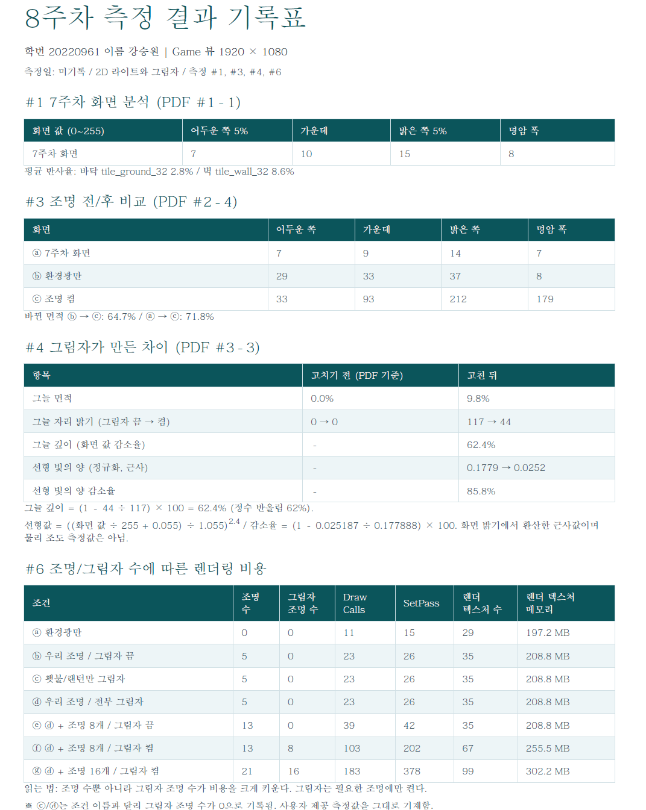

### 조명·그림자 적용 전후 비교

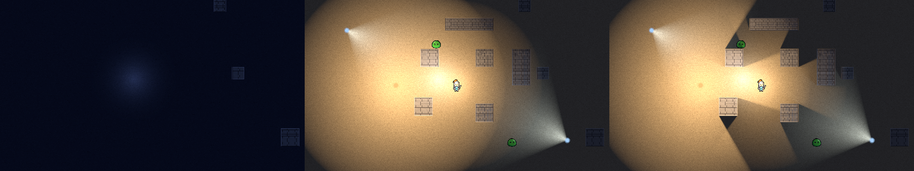

왼쪽부터 7주차 화면, 조명 적용, 조명과 그림자를 함께 적용한 화면이다. 조명으로 밝은 영역과 어두운 영역을 나누고, 기둥 뒤에 그림자를 만들어 공간의 구조를 표현했다.

### 플레이어 이동과 그림자 GIF


플레이어가 랜턴을 들고 기둥 사이를 이동하면서 빛과 그림자의 변화를 확인하였다. 빛의 위치에 따라 그림자의 방향이 달라지고, 기둥에 가까워지면 그림자가 넓게 퍼지는 모습을 살펴보았다.

### 추가 분석 — 조명 적용과 명암 폭

측정 #3에서 7주차 화면의 명암 폭은 7, 환경광만 적용한 화면은 8, 조명을 켠 화면은 179였다. 환경광만으로는 밝기 범위가 좁았지만, 방향이 있는 조명을 배치한 후 밝은 곳과 어두운 곳의 차이가 커졌다.

어두운 분위기를 만들기 위해 원본 그림 자체를 지나치게 어둡게 하면 조명을 받아도 밝아지기 어렵다. 그림의 반사율을 확보하고 낮은 환경광과 부분 조명으로 어둠을 구성하는 방식이 명암 표현에 유리했다.

### 추가 분석 — 그림자가 만든 차이

그림자 설정을 수정한 후 그늘 면적은 9.8%로 나타났으며, 그늘 자리의 화면 밝기는 117에서 44로 감소했다. 화면 값 기준 그늘 깊이는 약 62.4%이다.

이를 sRGB에서 선형값으로 환산하면 약 0.1779에서 0.0252로, 빛의 양은 약 85.8% 감소한 것으로 계산된다. 화면 값의 감소율과 선형 빛의 감소율은 다르므로 구분해서 해석해야 한다. 이 값은 화면 밝기에서 환산한 근사값이다.

### 추가 분석 — 조명 수와 그림자 비용

ⓓ에서 ⓔ로 일반 조명 8개를 추가했을 때 Draw Calls와 SetPass는 각각 16회 증가했고, 렌더 텍스처 수와 메모리는 같았다.

같은 조명 수에서 ⓔ와 ⓕ를 비교하면, 추가 조명 8개의 그림자를 켰을 때 Draw Calls는 64회, SetPass는 160회 증가했다. 렌더 텍스처는 32개, 메모리는 46.7MB 증가했다.

이번 측정에서는 일반 조명 추가보다 그림자 활성화의 비용이 더 크게 나타났다. 따라서 플레이어 랜턴이나 주요 횃불처럼 효과가 잘 보이는 조명에 그림자를 우선 적용하고, 수가 많은 투사체 조명 등은 그림자를 끄는 구성이 적절하다.

※ ⓒ와 ⓓ는 조건 이름과 달리 그림자 조명 수가 0으로 기록되었다. 두 조건의 비용이 같은 이유를 해석하려면 실제 Shadows 활성 상태를 추가로 확인해야 한다.

## 4. 실행 방법

### 에디터에서 실행

```
1. Unity 6000.5.1f1로 프로젝트 열기
2. Assets/StarterProject/Scenes/SampleScene 열기
3. ▶ Play 버튼 클릭
```

### 웹 빌드 실행

```
1. File → Build Profiles → Web 선택
2. Build And Run 클릭
3. 브라우저에서 자동 실행 확인
```

---

## 5. 트러블슈팅 기록

> 진행 중 겪은 문제와 해결 과정을 기록하세요 (선택 사항이지만 권장).

| 문제 | 원인 | 해결 방법 |
|---|---|---|
| TilemapLab 스크립트는 있었지만 Hierarchy에 TilemapLab 오브젝트가 보이지 않았다. | 열어둔 씬과 TilemapLab 오브젝트가 배치된 실습 씬이 달랐다. | TilemapLab이 배치된 실습 씬을 열고 Hierarchy에서 오브젝트를 확인했다. |
| 5주차 — 기존 에셋으로 복구했을 때 원하는 적용 전 모습 대신 초기 파란색 원 플레이어로 돌아감 | 복구된 상태가 원하는 중간 작업 상태와 달랐음. 복구는 작업 단계 선택이 아니라 백업된 스프라이트 참조를 기준으로 동작함 | 원하는 기사 스프라이트를 Art Studio의 Player 슬롯에 지정하여 다시 적용함. 이후 복구 전 백업 시점과 내용을 확인하도록 함 |
| 5주차 — 브라우저 측정 코드를 실행했을 때 `Unexpected token '}'` 오류 발생 | 콘솔에 입력한 코드에서 중괄호 짝이 맞지 않는 구문 오류 발생 | 입력 중인 코드를 지우고 측정 코드 전체를 다시 붙여 넣어 실행함 |
| 7주차 — 노멀 맵을 연결했지만 조명을 움직여도 입체감이 나타나지 않음 | Spot Light 2D의 Normal Maps → Quality가 Disabled로 설정되어 노멀 맵을 활용하지 않음 | Inspector에서 Quality를 Accurate로 변경하고, 조명을 좌우로 움직여 명암 변화를 확인함 |
| 8주차 — 벽에 Shadow Caster 2D를 추가했지만 그림자가 나타나지 않음 | Casting Source가 TilemapCollider2D로 지정되어 그림자 도형이 생성되지 않음. 합쳐진 충돌 도형은 CompositeCollider2D에 있었음 | Casting Source를 CompositeCollider2D로 변경하고, 조명의 Shadows 활성 상태를 확인한 뒤 그늘이 생성되는지 확인함 |

| | | |

---

## 6. 참고 자료
- 수업 자료: 2주차 PPT
