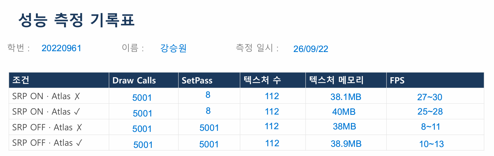
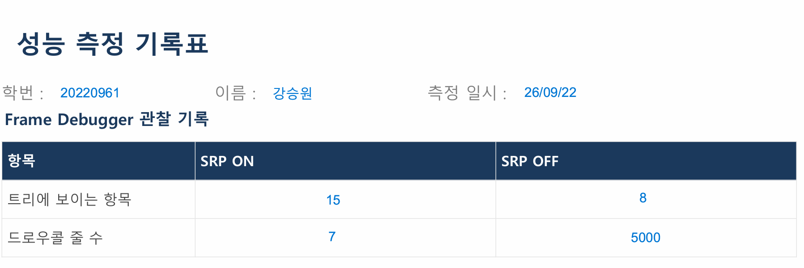
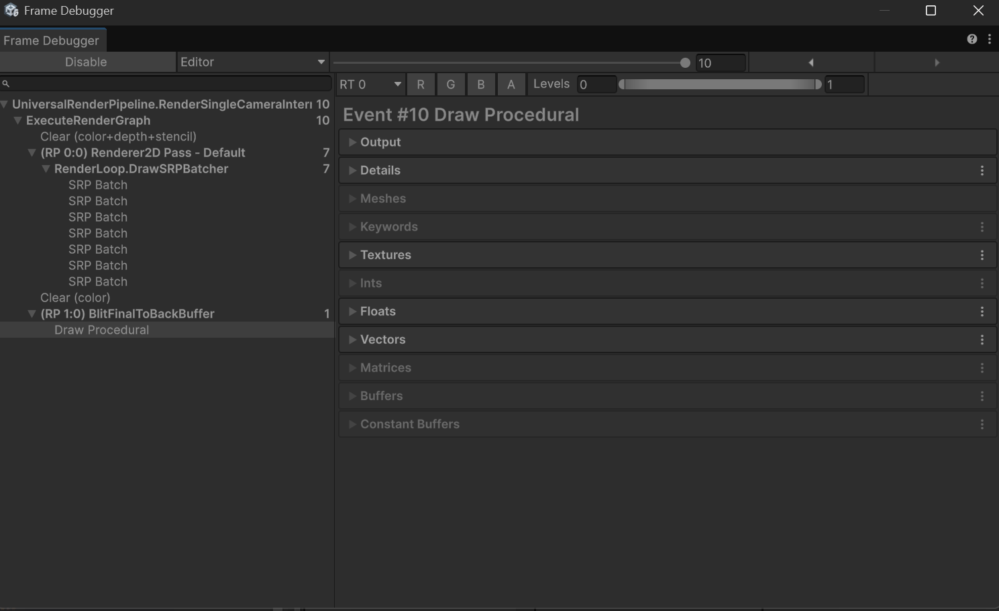
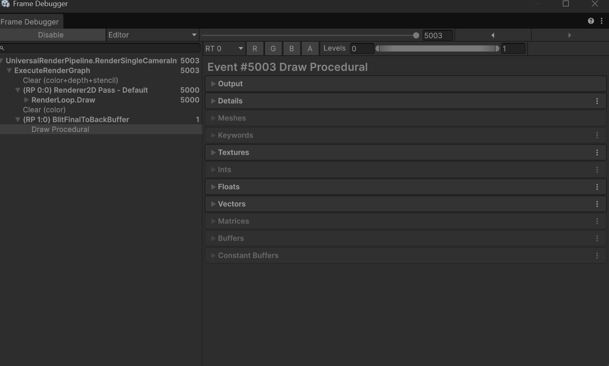
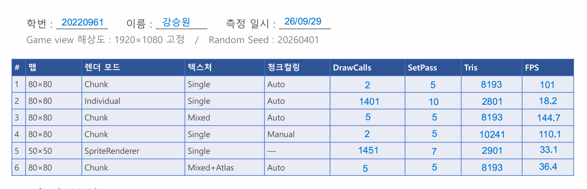
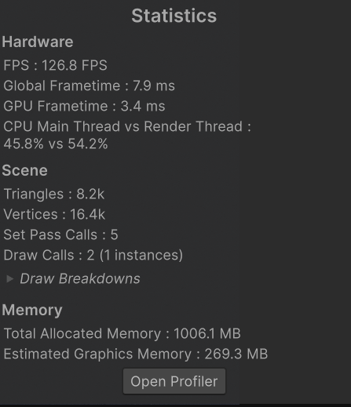
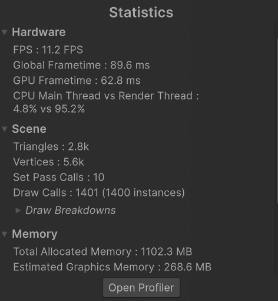
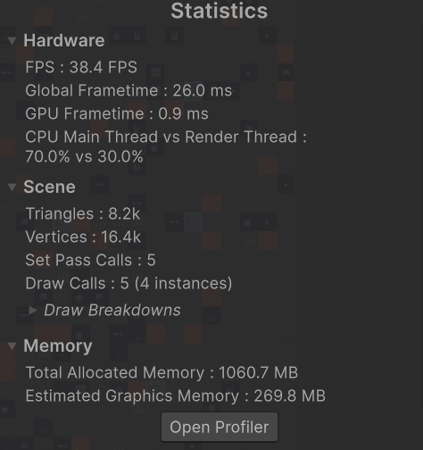

# [프로젝트명] — 웹게임(2D) 기반 그래픽 실습

> 컴퓨터그래픽스(2) | 2026학년도 2학기 | 담당교수: 최도현
> 작성자: (학번) / (이름)
> 최종 수정일: (YYYY-MM-DD)

---

## 목차

1. [프로젝트 개요](#1-프로젝트-개요)
2. [개발 환경](#2-개발-환경)
3. [x 주차 별 세부 내용]
4. [실행 방법](#5-실행-방법)
5. [트러블슈팅 기록](#6-트러블슈팅-기록)
6. [참고 자료](#7-참고-자료)

---

## 1. 프로젝트 개요

| 항목 | 내용 |
|---|---|
| 프로젝트명 | (예: Survivor 2D) |
| 장르 | 2D 탑뷰 서바이벌 액션 (Vampire Survivors 스타일) |
| 플랫폼 | Web (WebGL2) |
| 조작 | WASD / 방향키 이동, 자동 공격 |
| 한 줄 소개 | (자신의 게임을 한 문장으로 설명) |

---

## 2. 개발 환경

| 항목 | 값 |
|---|---|
| Unity 버전 | 6000.5.1f1 |
| Render Pipeline | Universal RP (2D Renderer) |
| Input System | New Input System (Input System Package) |
| UI | TextMesh Pro |
| 웹 빌드 | WebGL 2 (WebGPU 실험적 지원 별도) |

---

## 3. 2주차 — 프로젝트 준비 & 웹 빌드

### 3.1 프로젝트 초기 세팅

- [x] Unity 6000.5.1f1로 2D URP 템플릿 프로젝트 생성
- [x] `2주차_StarterProject.unitypackage` 임포트
- [x] `CG2 Starter → Step 1 → Step 2 → Step 3` 순서로 씬 빌드
- [x] ▶ Play 버튼으로 정상 동작 확인 (WASD 이동, 자동 공격, 적 스폰)

### 3.2 씬 구성 요약

```
Player      SpriteRenderer(Order 2) · Rigidbody2D · CircleCollider2D
            PlayerController · HitReceiver · Health · WeaponController

Enemy       SpriteRenderer(Order 1) · Rigidbody2D · CircleCollider2D
            EnemyAI · HitReceiver · Health

Projectile  SpriteRenderer(Order 3) · Rigidbody2D · CircleCollider2D(Trigger)
            Projectile

Canvas      Screen Space - Overlay · HUD(Script)
            HpBar / ExpBar / ScoreText / LevelText / TimeText / GameOverPanel
```

### 3.3 웹 빌드 확인

- [x] `File → Build Profiles → Web → Build And Run`으로 브라우저 실행 확인
- [x] 빌드 소요 시간: 약 ( )분
- [x] 브라우저 정상 실행 여부: (예/아니오)

**웹 빌드 vs 에디터 Play 차이**

| 항목 | 에디터 Play | 웹 빌드 |
|---|---|---|
| 실행 속도 | 즉시 | 1~3분 |
| 확인 목적 | 로직 테스트 | 실제 브라우저 동작 확인 |

### 3.4 GitHub 업로드 체크리스트

- [x] `.gitignore`에 `Library/`, `Temp/`, `Obj/`, `Build/`, `Logs/`, `UserSettings/` 포함 확인
- [x] `Assets/`, `ProjectSettings/`, `Packages/`는 반드시 포함
- [x] 개별 파일 100MB 초과 여부 확인 (대용량은 Git LFS 고려)

### 3.5 2주차 문제 
| PPU 32 | Scale 2 |
| :---: | :---: |
|  |  |

PPU 32와 Scale 2 비교

두 실행 화면에서 파란색 플레이어 원은 거의 같은 크기로 보였다. PPU를 64에서 32로 낮추거나 Transform Scale을 1에서 2로 높이면, 두 경우 모두 스프라이트의 가로와 세로가 월드에서 각각 2배가 된다.

PPU 32는 스프라이트 이미지의 픽셀을 월드 크기로 환산하는 기준을 바꾼다. 같은 스프라이트 에셋을 사용하는 다른 오브젝트에도 적용된다.

Scale 2는 선택한 오브젝트의 Transform 크기를 2배로 늘린다. 해당 오브젝트에 붙은 콜라이더와 자식 오브젝트도 함께 스케일된다.

## 3주차 — Batching과 Sprite Atlas

### 실습 내용 정리

SRP Batcher와 Sprite Atlas를 각각 켜고 끄면서 Draw Calls, SetPass, 텍스처 수, 텍스처 메모리, FPS를 비교했다.

- **SRP Batcher**는 렌더링 상태를 준비하는 CPU 비용을 줄인다. Draw Calls가 그대로여도 SetPass가 줄어들 수 있다.
- **Sprite Atlas**는 여러 스프라이트를 하나의 텍스처로 묶는다. 텍스처 전환과 Draw Calls를 줄일 수 있고, 아틀라스 크기에 따라 텍스처 메모리는 늘어날 수 있다.
- **Frame Debugger**에서는 SRP Batcher ON/OFF에 따라 렌더링 트리에 표시되는 항목과 드로우콜 줄 수를 비교했다.

### 성능 측정 기록표



### Frame Debugger 관찰 기록표



### Frame Debugger 캡처 비교

| SRP ON | SRP OFF |
| :---: | :---: |
|  |  |

## 4주차 — Tilemap 렌더링 최적화

### 실습 내용 정리

TilemapLab에서 Chunk와 Individual 렌더링을 비교하고, 텍스처 구성과 청크 컬링 설정이 Draw Calls, SetPass, Tris, FPS에 어떤 영향을 주는지 확인했다.

- **Chunk 모드**는 타일을 청크 단위로 묶어 그린다. #1 Chunk는 Draw Calls 2회, #2 Individual은 1,401회였다. Individual에서 Tris는 줄었지만, FPS도 101에서 18.2로 낮아졌다.
- **청크 컬링**은 카메라에 보이지 않는 청크를 렌더링에서 제외한다. #4에서 컬링 범위를 수동으로 넓히자 Draw Calls는 2회로 같았지만, Tris는 8,193에서 10,241로 늘었다.
- 바닥처럼 캐릭터와 앞뒤 정렬이 필요 없는 타일은 Chunk를 사용하고, 캐릭터와의 정렬이 필요한 타일은 별도 타일맵에 두고 Individual을 적용할 수 있다.

### 측정 기록표



### Game 뷰 Stats 비교

| #1 Chunk | #2 Individual | #6 Mixed + Atlas |
| :---: | :---: | :---: |
|  |  |  |

### 추가 분석 — Mixed와 Mixed + Atlas 비교

#3 Mixed와 #6 Mixed + Atlas는 Draw Calls 5회, SetPass 5회, Tris 8,193으로 같았다. 기록된 FPS는 #3에서 144.7, #6에서 36.4였다. 이번 측정에서 Atlas 적용 후 Draw Calls나 SetPass의 감소는 관찰되지 않았다. FPS 차이의 원인은 이 기록만으로 확인하기 어려우므로, 같은 조건에서 여러 번 측정해 비교할 필요가 있다.

## 4. 실행 방법

### 에디터에서 실행

```
1. Unity 6000.5.1f1로 프로젝트 열기
2. Assets/StarterProject/Scenes/SampleScene 열기
3. ▶ Play 버튼 클릭
```

### 웹 빌드 실행

```
1. File → Build Profiles → Web 선택
2. Build And Run 클릭
3. 브라우저에서 자동 실행 확인
```

---

## 5. 트러블슈팅 기록

> 진행 중 겪은 문제와 해결 과정을 기록하세요 (선택 사항이지만 권장).

| 문제 | 원인 | 해결 방법 |
|---|---|---|
| TilemapLab 스크립트는 있었지만 Hierarchy에 TilemapLab 오브젝트가 보이지 않았다. | 열어둔 씬과 TilemapLab 오브젝트가 배치된 실습 씬이 달랐다. | TilemapLab이 배치된 실습 씬을 열고 Hierarchy에서 오브젝트를 확인했다. |

| | | |

---

## 6. 참고 자료
- 수업 자료: 2주차 PPT
