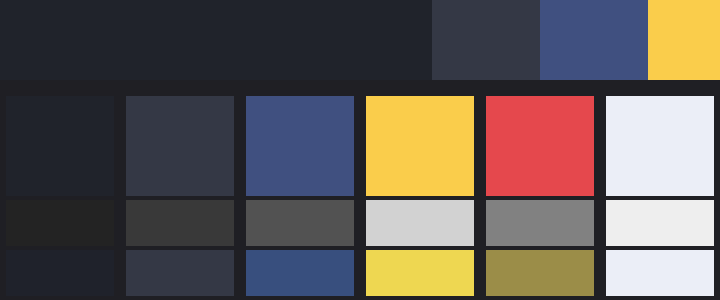

# 아트 가이드 — WEB2D_4_2022061

> 테마 **My Palette** · 조화 규칙 보색 · Color Space **Linear** · 생성 2026-10-23 12:35
> 이 문서는 `CG2 Lab → 6주차 → 5`가 프로젝트에 실제로 적용된 값에서 자동으로 만든다. 값을 바꾸면 다시 내보낸다.

## 1. 색 공간

- Project Settings → Player → Color Space = **Linear** (URP · WebGL 2 권장)
- 색 텍스처(스프라이트·UI 아이콘)는 `sRGB (Color Texture)` **켬**, 데이터 텍스처(노멀 맵·마스크)는 **끔** — 7주차 노멀 맵부터 적용

측정 #1 — 같은 씬, 두 색 공간 (화면 출력 0~255)

| 지점 | Linear | Gamma |
|---|---|---|
| A 회색 25% (64) | 64, 64, 64 | 64, 64, 64 |
| A 회색 50% (128) | 128, 128, 128 | 128, 128, 128 |
| A 회색 75% (191) | 191, 191, 191 | 191, 191, 191 |
| B 라이트 1개 (중심) | 186, 186, 186 | 127, 127, 126 |
| B 라이트 1개 (중심에서 1.5) | 93, 93, 92 | 64, 64, 64 |
| B 라이트 2개 겹침 (각각 1.5) | 128, 128, 128 | 128, 128, 127 |
| C 빨강 α0.5 (흰 바탕) | 255, 187, 187 | 255, 127, 127 |
| C 빨강+초록 겹침 | 187, 224, 136 | 127, 191, 63 |
| D sRGB ON  주황 | 224, 122, 48 | 224, 122, 48 |
| D sRGB OFF 주황 | 241, 184, 120 | 224, 122, 48 |

## 2. 팔레트 1 · 2 · 1

| 역할 | HEX | H | S | V | 흑백 밝기 | 면적 | 쓰는 곳 |
|---|---|---|---|---|---|---|---|
| Main | `#20232B` | 224° | 27 | 17 | 14% | 60% | 바닥 톤 · 배경 · HUD 띠 |
| Sub1 | `#343845` | 224° | 24 | 27 | 22% | 15% | 창·패널 바탕 |
| Sub2 | `#405080` | 224° | 50 | 50 | 32% | 15% | 버튼 · 상호작용 |
| Accent | `#FACD4B` | 44° | 70 | 98 | 82% | 10% | 제목 · 경험치 · 포커스 링 · 보상 |
| Danger | `#E5484D` | 358° | 69 | 90 | 50% | — | 체력 · 위험 (기능색) |
| Text | `#EBEEF7` | 224° | 5 | 97 | 93% | — | 글자 (기능색) |

### 검증

- ✅ 글자 / 창(Sub1) 10.03:1 (기준 4.5:1)
- ✅ 글자 / 버튼(Sub2) 6.77:1 (기준 4.5:1)
- ✅ 강조 / 바닥(Main) 10.40:1 (기준 3:1)
- ✅ 강조 제목 / 창(Sub1) 7.67:1 (기준 3:1)
- ✅ 체력바(Danger) / 바닥 4.03:1 (기준 3:1)
- ✅ 명도 위계 Main 14 < Sub1 22 < Sub2 32 < Accent 82 (흑백 %)
- ✅ 적록 색약에서 강조↔위험 색상 차 1° — 색으로는 구분 안 됨, 명도 차 29%로만 구분 (기준 25%) → 아이콘(♥/◆) 같은 모양 단서를 함께 쓴다
- ✅ 버튼 상태 명도 차 Hover +8% · Pressed −10% (각 5% 초과)

## 3. UI 상태 규칙

버튼 Image는 **흰색**, 색은 Button의 ColorBlock(Color Tint)이 맡는다. 상태색은 팔레트에서 계산한다.

| 상태 | 색 | 규칙 |
|---|---|---|
| Normal | `#405080` | Sub2 |
| Highlighted (호버) | `#4F639E` | Sub2 명도 +12% |
| Pressed | `#2D3859` | Sub2 명도 −15% |
| Selected (포커스) | `#405080` + 테두리 `#FACD4B` | 배경은 Normal, 강조색 9-슬라이스 테두리 3px |
| Disabled | `#5C5C5C` α0.6 | 채도 0 · 글자·아이콘 α0.4 |
| Fade Duration | 0.08 s | 즉각 반응 |

## 4. 씬 톤 · 개체 틴트

- 배경 조명 (Global Light 2D → Ground·Wall) `#BFD0FF` — Main 색상 · 채도 25% · 명도 100%
- 캐릭터 조명 (CG2 Entity Light → Default·Entity·FX) `#EFF3FF` — 흰색에 환경광 25%
- 카메라 배경 `#20232B`
- Tilemap_Ground 틴트 0.70 · Tilemap_Wall 틴트 0.45 (흰색 ↔ 팔레트 색상 보간)
- 개체 틴트는 **`SpriteRenderer.color`(정점 색)** 만 쓴다. `material.color`(머티리얼 복제) · `MaterialPropertyBlock`은 금지

측정 #2 — 틴트 방법별 렌더링 비용

| 방법 | ON DrawCalls | ON SetPass | ON SRP Batch 경유 | OFF DrawCalls | OFF SetPass |
|---|---|---|---|---|---|
| 기준 (벤치 없음) | 26 | 14 | 17 | 12 | 16 |
| ① 틴트 없음 (흰색 100개) | 126 | 14 | 117 | 12 | 16 |
| ② SpriteRenderer.color | 126 | 14 | 117 | 12 | 16 |
| ③ material.color (복제 100개) | 126 | 14 | 117 | 112 | 116 |
| ④ MaterialPropertyBlock | 126 | 115 | 17 | 17 | 21 |

- 조명을 나누는 이유: 전역 조명 하나로 톤을 입히면 캐릭터까지 물들어 바닥에 묻힌다 (측정 #3-2의 '전역 조명 하나' 열)

## 5. 타이포그래피

- 본문·UI: **갈무리11 (Galmuri11)** · SIL OFL 1.1 · TMP Dynamic SDF · 샘플링 44pt — 픽셀 아트와 같은 격자감
- 제목 = Accent, 본문 = Text. 숫자·영문도 같은 서체로 통일
- 라이선스 전문: `Assets/CG2Week6/Fonts/Galmuri_OFL.txt` (게임과 함께 배포 가능)

## 6. 접근성

- 흑백으로 봐도 바닥 < 창 < 버튼 < 강조 명도 순서가 유지된다 (2-1 미리보기 캡처로 확인)
- 색만으로 정보를 전달하지 않는다 — HP ♥ / EXP ◆ 아이콘, Disabled 글자 흐림, 포커스는 테두리

## 7. 하지 말 것

- 코드·Inspector에 색을 직접 적기 (`new Color(...)`) → 팔레트 에셋의 역할 이름으로 쓴다
- 버튼 Image에 색 넣기 → Color Tint와 곱해져 상태색이 어두워진다
- 강조색 배경 위 흰 글자 → 대비 부족 (포커스는 테두리로)
- 색 텍스처의 sRGB 끄기 / 노멀 맵의 sRGB 켜기
- 개체 틴트에 `renderer.material` 접근 → 머티리얼 복제 · 누수

색 감사 (2-0): 5주차 10색 중 하드코딩 10개 → 팔레트 적용 후 (2-0 다시 실행)
